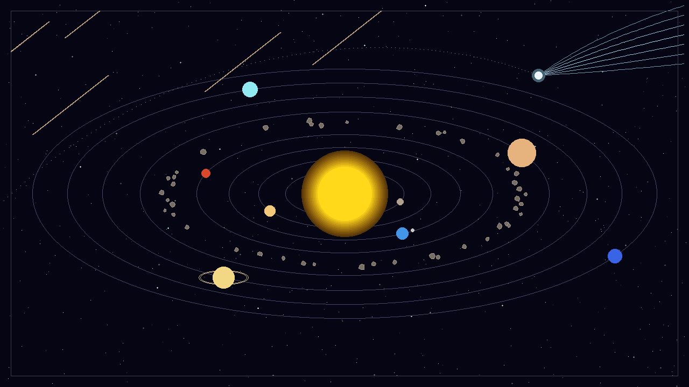

# Solar System with Comets & Meteors — ICS 3204 Computer Graphics
Team: [A name], [B name], [C name]

A solar system scene drawn pixel by pixel in pure C++ (no graphics libraries).
Every shape uses our own implementation of a course algorithm.



## Build and run
```
g++ -std=c++17 -Iinclude src/*.cpp scenes/main.cpp -o scene
./scene            # writes out/scene.ppm
```

## Who did what
- A: Canvas, DDA, Bresenham, Cohen–Sutherland clipping, HSV colour, starfield, meteors
- B: midpoint circle and ellipse, polygons, scanline fill, sun, planets, asteroids
- C: Bézier curves, comet, scene composition
