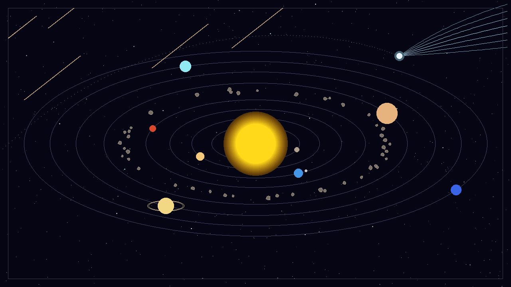

# Checkpoint 2 — Solar System with Comets & Meteors
Team: [A name], [B name], [C name]

## Algorithms implemented
| Algorithm | File | Used for | By |
|---|---|---|---|
| DDA line | src/lines.cpp | line test (comparison with Bresenham) | A |
| Bresenham line | src/lines.cpp | meteors, comet tail, polygon outlines, viewport frame | A |
| Cohen–Sutherland clipping | src/lines.cpp | meteors cut at the viewport frame | A |
| RGB↔HSV | src/color.cpp | starfield, planet colours, sun glow | A |
| Midpoint circle (filled) | src/shapes.cpp | sun, planets, moon, comet head | B |
| Midpoint ellipse | src/shapes.cpp | orbits, Saturn's ring | B |
| Polygon + scanline fill | src/polygon.cpp | asteroids | B |
| Bézier (de Casteljau) | src/curves.cpp | comet path and tail | C |

## Current scene

## GitHub
https://github.com/NJ-IVE/solar-system-cg (tag: checkpoint-2)

## What remains
- Transformations: planets rotating around the sun, moon around Earth (Phase 3)
- Animation: comet moving along its Bézier path, meteors falling (Phase 3)
- OpenGL integration (Phase 4)
- Stretch items not yet done: boundary fill for planet bands, Catmull–Rom asteroid belt, parallel line drawing
